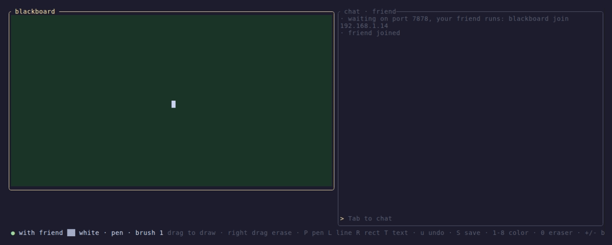

# BlackBoardCLI



A shared blackboard and a chat for two people, right into your terminal, on Linux, Windows and MacOS. You can draw and write together in real time, either over the same local network, or from anywhere through a relay, with a room code.

## Features
- Shared 80 x 24 cell board with 8 colors and an eraser
- Tools: free hand, lines, rectangles and text and fill, with mouse or keyboard and an adjustable brush
- Undo (`u` or `Crtl+z`) that takes back only your own strokes, never what your friend drew on top 
- Save the board (`S`) and open it again later with `host --open`, plus a plain-text copy to paste anywhere
- Built-in chat and live cursor sharing
- Direct connection on a local network, or a WebSocket relay with temporary room codes
- A public relay on `wss://`, so it works through school and office firewalls :)

## How to use it

### From two different networks (public relay)

On the computer hosting the board, run:

```sh
blackboard host --relay
```

The host gets a room code like `K7P2QX`. The other person can join from anywhere with:

```sh
blackboard join K7P2QX
```

Rooms code are case-insensitive, and a room waits 15 minutes for its guest.

### On the same network

On the computer hosting the board, run:

```sh
blackboard host 
```

The program will display a command to share with the other person, including its local ip address. On their computer, use the ip address shown by the host:

```sh
blackboard join 192.168.1.19
```

Replace `192.168.1.19` with the address displayed by the host. The default port is `7878`; if you choose a different port, include it in the ip address, for example `192.168.1.19:9000`. The host's firewall must allow TCP connections on that port

### Your own relay

To host your own relay server, run:

```sh
blackboard relay
```

By default, it listens on port `ws://0.0.0.0:7879`. Both sides can then pass its address with `--relay`

```sh
blackboard host --relay 10.0.0.5
blackboard join K7P2QX --relay 10.0.0.5
```

An address without a scheme defaults to `ws://` on port `7879`. Instead of passing `--relay`, you can set the `BLACKBOARD_RELAY` environment variable to teh relay address.

To put the relay online with TLS, run it behind a reverse proxy that speaks HTTPS (Caddy, nginx f.e.) and pass that server's address with `--trust-proxy`, so the per-address connection limit counts real clients. A Docker image and a compose file are available in `Dockerfile` and `deploy/`

## Tech Stack
- Rust 2024
- Ratatui + crossterm (TUI and mouse)

## Requirements
- Linux, Windows 10/11 or MacOS 11 or newer
- A terminal with mouse support: any Linux terminal, Windows terminal (built into Windows 11), the macOS Terminal or iTerm2
- To build from source, Rust 1.88+
- For hosting your own relay, a small server or Docker

## Install

Download the file for your system from the [Releases](https://github.com/AlessioFerrari8/BlackBoardCLI/releases) page.
Each one has a `.sha256` file next to it, to check the download. 

| System | File |
| --- | --- |
| Linux (x86_64) | `blackboard-v0.2.0-linux-x86_64` |
| Windows (x86_64) | `blackboard-v0.2.0-windows-x86_64.exe` |
| macOS, Apple Silicon (M1 and later) | `blackboard-v0.2.0-macos-aarch64` |
| macOS, Intel | `blackboard-v0.2.0-macos-x86_64` |

### Linux

```sh
mv blackboard-v0.2.0-linux-x86_64 blackboard
chmod +x blackboard
./blackboard host --relay
```

### Windows 

Open Windows Terminal (or PowerShell) in the folder with the download:

```powershell
Rename-Item blackboard-v0.2.0-windows-x86_64.exe blackboard.exe
.\blackboard.exe host --relay
```

The binary is not signed, so SmartScreen may say "Windows protected your PC": choose **More info**, then **Run anyway**.
The first time you run `blackboard host` without `--relay`, Windows Firewall asks whether to allow it: allow it on
**private networks**, or your friend cannot connect. The relay modes need no firewall rule. 

### macOS

```sh
mv blackboard-v0.2.0-macos-aarch64 blackboard # or blackboard-v0.2.0-macos-x86_64 on an Intel Mac
chmod +x blackboard
xattr -d com.apple.quarantine blackboard
./blackboard host --relay
```

The binary is not signe by Apple: without the `xattr` line, macOS says it "cannot be opened because the developer cannot be verified", or something like that. When you run `blackboard host` without `--relay`, macOS may ask whether to accept incoming connections: choose **Allow**.

On macOS the shortcuts use **Ctrl**, not Cmd: undo is `Ctrl+Z`, quit is 'Ctrl+C`.

### With Cargo

On any system with Rust installed:

```
cargo install --locked --git https://github.com/AlessioFerrari8/BlackBoardCLI
```


## Build

Clone the repo and build the project

```sh
git clone [https://github.com/AlessioFerrari8/BlackBoardCLI.git](https://github.com/AlessioFerrari8/BlackBoardCLI.git)
cd BlackBoardCLI
cargo build --release
```

The compiled program is available at `target/release/blackboard` (`target\release\blackboard.exe` on Windows). During development, you can also run it with `cargo run --`


## Commands

```text
blackboard host  [--relay [URL]] [--open FILE] [--port PORT]
                 [--bind IP] [--name NAME]
blackboard join  CODE|ADDRESS [--relay URL] [--name NAME]
blackboard relay [--port PORT] [--bind IP] [--max-rooms N]
                 [--max-per-ip N] [--trust-proxy IP]...
```

- `host`: opens a board and waits for someone to join. In direct
  mode, it listens on port `7878`.
- `join`: connects to the host's address or, with a room code,
  joins through a relay.
- `relay`: starts a relay server, which listens on port `7879` by
  default.
- `--relay`: uses the default public relay (when passed to `host`
  without a URL) or connects to a custom relay URL.
- `--open`: loads a previously saved `.board` file when hosting.
- `--bind`: the IP address to listen on; defaults to `0.0.0.0`.
- `--name`: the name shown in chat. If omitted, the system username
  is used.
- `--trust-proxy`: trusts `X-Forwarded-For` headers from the
  specified reverse proxy IP(s).

You can view all available options in the terminal:

```sh
blackboard --help
blackboard host --help
blackboard join --help
blackboard relay --help
```

## Controls

When the board is focused:

| Key or action | Effect |
| --- | --- |
| Drag with the left mouse button | Draw with the current tool |
| Drag with the right mouse button | Erase |
| `P`, `L`, `R`, `T`, `F` | Select Pen, Line, Rectangle, Text or Fill tool |
| `1`–`8` | Select a chalk color |
| `0` or `e` | Select the eraser |
| `+` / `-` | Increase or decrease brush size |
| Arrow keys or `h` `j` `k` `l` | Move the cursor |
| `Space` | Draw at the cursor (lines/rectangles: once per end) |
| `Esc` | Drop the shape in progress |
| `u` or `Ctrl+Z` | Undo your last stroke |
| `S` | Save the board |
| `C` | Clear the board |
| `Tab` or `t` | Focus the chat |
| `q` | Quit |

While writing text:

| Key | Effect |
| --- | --- |
| Any character | Write on the board |
| `Enter` | Start a new line under the first letter |
| `Backspace` | Delete a character |
| `Esc` | Stop writing text |

When the chat is focused:

| Key | Effect |
| --- | --- |
| `Enter` | Send the message |
| `Esc` or `Tab` | Return to the board |
| `Backspace` | Delete a character |
| `Ctrl+C` or `Ctrl+Q` | Quit |

## Saved boards

Pressing `S` writes `board-1.board` and `board-1.txt` in the
current folder, and never overwrites an older save (the next one
is `board-2`). Open a saved board again with:

```sh
blackboard host --open board-1.board
```

## Development and testing

Run the test suite and linter with:

```sh
cargo test
cargo clippy --all-targets
```