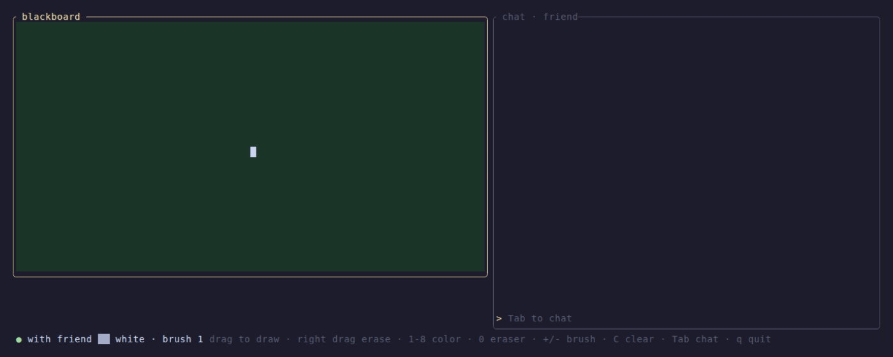

# BlackBoardCLI



A shared blackboard and a chat for two people, right into your terminal. You can draw together in real time, either over the same local network, or through a relay, using a room code.

## Features
- Shared 80 x 24 cell board with 8 colors and an eraser
- Draw with the mouse or keyboard, with an adjustable brush size
- Built-in chat and live cursor sharing
- Connection directly over a local network or through a relay
- Relay server included, with temporary room codes

## How to use it

### Direct connection over the same network

On the computer hosting the board, becoming the server, run

```sh
blackboard host
```

The program will display a command to share with the other person. On their computer, use the ip address shown by the host:

```sh
blackboard join 192.168.1.19
```

Replace `192.168.1.19` with the address displayed by the host. The default port is `7878`; if you choose a different port, include it in the ip address, for example `192.168.1.19:9000`. The host's firewall must allow TCP connections on that port

### Connect through a relay

To connect people on different networks, start a relay that both participants can reach. You can run it on a dedicated server:

```sh
blackboard relay
```

By default, the relay listens on port `7879`. If it runs on a remote machine, configure the network and firewall so both participants can connect to it.

The host opens a room by specifying the relay address:

```sh
blackboard host --relay relay.example.org:7879
```

Share the room code displayed by the program. The other person can join with:

```sh
blackboard join CODE --relay relay.example.org:7879
```
Room codes are case-insensitive. Instead of passing `--relay` you can set the `BLACKBOARD_RELAY` environment variable to the relay address.

## Tech Stack
- Rust 2024
- Ratatui + crossterm (TUI and mouse)


## Requirements
- Rust 1.88+
- A terminal that support TUI features and mouse events
- For relay mode, a small server

## Install
Download `blackboard-v0.1.0-linux-x86_64` from the Releases page, then:
```sh
chmod +x blackboard-v0.1.0-linux-x86_64
./blackboard-v0.1.0-linux-x86_64 host
```

## Build

Clone the repo and build the project

```sh
git clone https://github.com/AlessioFerrari8/BlackBoardCLI.git
cd BlackBoardCLI
cargo build --release
```

The compiled program is available at `target/release/blackboard`. During development, you can also run it with `cargo run --`


## Commands

```text
blackboard host [--port PORT] [--bind IP] [--name NAME] [--relay HOST:PORT]
blackboard join ADDRESS [--name NAME] [--relay HOST:PORT]
blackboard relay [--port PORT] [--bind IP] [--max-rooms NUMBER] [--max-per-ip NUMBER]
```

- `host`: opens a board and waits for someone to join. In direct mode, it listens on port `7878`.
- `join`: connects to the host's address or, with `--relay`, uses the provided value as a room code.
- `relay`: starts the relay server, which listens on port `7879` by default.
- `--bind`: the IP address to listen on; defaults to `0.0.0.0`.
- `--name`: the name shown in chat. If omitted, the system username is used.

You can view all available options in the terminal:

```sh
blackboard --help
blackboard host --help
blackboard join --help
blackboard relay --help
```

## Controls

When the board is focused:

| Key or action | Effect |
| --- | --- |
| Drag with the left mouse button | Draw with the selected color |
| Drag with the right mouse button | Erase |
| `1`–`8` | Select a color |
| `0` or `e` | Select the eraser |
| `+` / `-` | Increase or decrease brush size |
| `C` | Clear the board |
| Arrow keys or `h` `j` `k` `l` | Move the cursor |
| Space | Draw under the cursor |
| `Tab` or `t` | Focus the chat |
| `q` | Quit |

When the chat is focused:

| Key | Effect |
| --- | --- |
| `Enter` | Send the message |
| `Esc` or `Tab` | Return to the board |
| `Backspace` | Delete a character |
| `Ctrl+C` or `Ctrl+Q` | Quit |

## Development and testing

Run the test suite with:

```sh
cargo test
```


